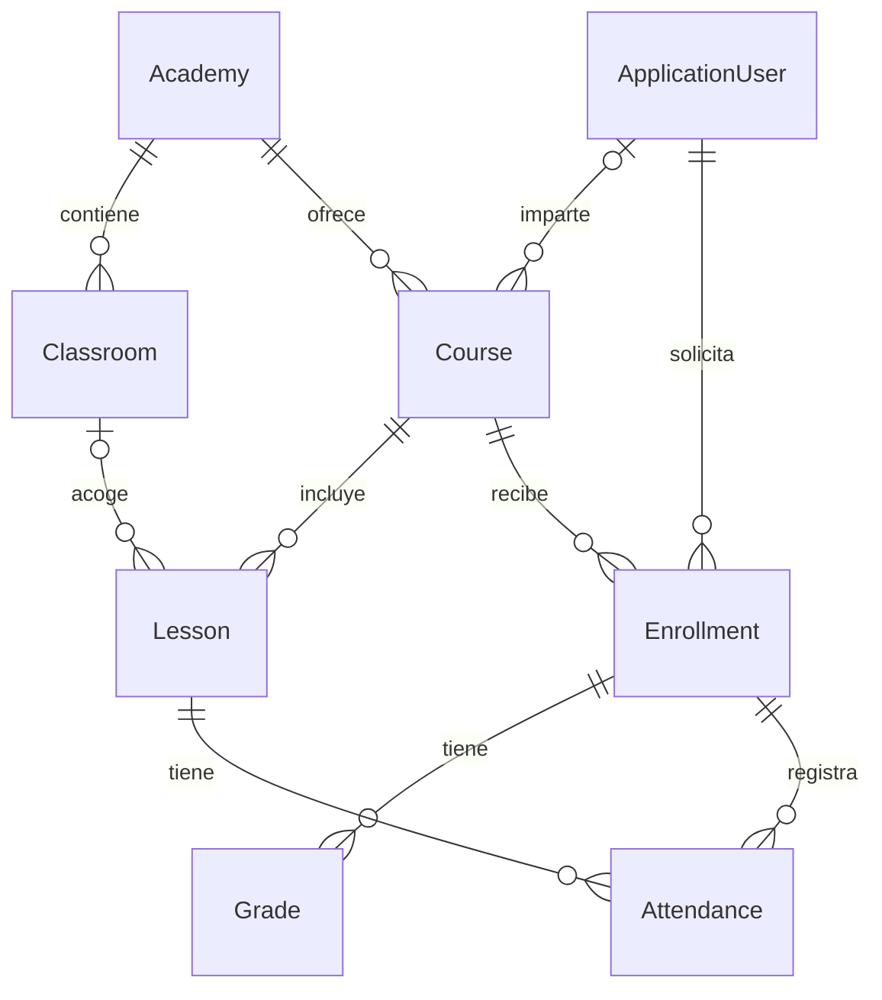

# Modelo de datos

| Entidad | Contenido y relaciones principales |
| --- | --- |
| `ApplicationUser` | Cuenta de Identity, nombre visible, avatar, fecha de alta y estado activo. Puede actuar como profesor de cursos o alumno de matrículas. |
| `Academy` | Centro de formación con dirección, ciudad, teléfono, aulas y cursos. |
| `Classroom` | Aula física o virtual de un centro, con capacidad y estado activo. Las virtuales requieren URL de reunión. |
| `Course` | Curso de un centro, con profesor opcional, nivel, precio, fechas, plazas máximas y estado. |
| `Lesson` | Sesión de un curso, con fecha y hora de inicio y fin y aula opcional. |
| `Enrollment` | Matrícula que relaciona una cuenta con un curso; incluye fecha, estado y marca de pago. |
| `Grade` | Calificación de una matrícula, con nota entre 0 y 10, tipo, fecha y comentario. |
| `Attendance` | Asistencia de una matrícula a una lección, con estado presente, ausente, tarde o justificado. |

Relaciones principales:

### Reglas de integridad

- El índice único de `Attendance` impide repetir la pareja `LessonId` y `EnrollmentId`.
- Las relaciones impiden borrar un centro con cursos o aulas, un profesor con cursos, un alumno con matrículas o un curso con matrículas.
- Una matrícula con notas o asistencias no se puede eliminar.
- El modelo configura la eliminación en cascada de las lecciones de un curso y de las asistencias de una lección.
- El modelo configura que, al borrar un aula, sus lecciones queden sin aula asignada.

Las dos últimas reglas describen el comportamiento de las relaciones; las acciones de eliminación de aulas y lecciones permanecen comentadas. La configuración completa está en [ApplicationDbContext.cs](https://github.com/certidevs/g2_aspnet/blob/main/Data/ApplicationDbContext.cs).

El ciclo de vida de SQLite se explica en [Base de datos y migraciones](https://github.com/certidevs/g2_aspnet/wiki/Base-de-datos-y-migraciones).

---

[Inicio](https://github.com/certidevs/g2_aspnet/wiki/Home) · [Documentación](https://github.com/certidevs/g2_aspnet/wiki/Home#documentación) · [Repositorio](https://github.com/certidevs/g2_aspnet) · [Comunicar un error](https://github.com/certidevs/g2_aspnet/issues)
